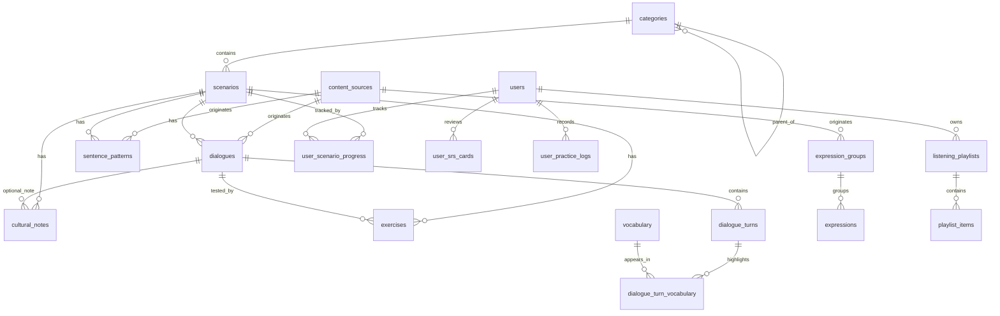

# 英文對話練習教學網站 — 功能與資料庫規劃書

> 本規劃依據 NotebookLM 筆記本 **「英文對話練習」**（共 10 份來源教材）的內容結構、情境分類與教學方法量身設計，旨在打造一個兼顧**「聽力磨耳朵」、「直覺反應開口」、「實戰情境演練」**與**「道地美式口語升級」**的互動式英文教學平台。

---

## 一、NotebookLM 教材盤點與產品定位

### 1. 教材來源對應分析
筆記本內 10 份教材可歸納為四大內容支柱：

| 來源類型 | 代表教材 | 網站對應核心價值 |
| :--- | :--- | :--- |
| **生活微場景迷你對話** | *Spoken English Conversation Practice: 500 Mini-Dialogues for Beginners* | 涵蓋起床到就寢 24 小時生活動作、附 IPA 音標、英美用法對照與課後反向翻譯測驗 |
| **美式口語與語氣表達庫** | *McGraw-Hill's Conversational American English*、時代國際日常句型、口說卡關救星 | 464 主題近 5,000 句替換表達、正式度/俚語標註、教科書 vs. 道地美式緩衝語氣對照 |
| **出國旅遊與購物實戰** | Prep Edu 9大旅遊情境+180句型、TutorABC 旅遊會話、巨匠美語逛街購物 | 自助行 vs. 跟團分流、店員/顧客雙向對照、可替換詞槽句型、小費/退稅/緊急自保指南 |
| **沉浸聽力與情境跟讀** | 3秒一問一答 60 組、一小時磨耳朵聊天攻略、公園慢跑情境動畫 | 常速➜慢速➜中文循環節奏、3 秒直覺反應訓練、四步驟 Shadowing 跟讀法 |

### 2. 四大主題領域（Content Domains）
1. **旅遊出行（Travel & Survival）**：機場劃位與安檢、機艙廣播、計程車與大眾運輸、問路地標、飯店入住/房務/退房、餐廳訂位/點餐/過敏飲食/結帳、緊急求助（遺失護照、生病、報警、聯絡大使館）。
2. **居家起居與生活作息（Daily Routines & Household）**：早晨起床、衛浴盥洗與美妝護理、更衣穿搭、餐飲料理、客廳休閒與桌遊牌類、家事打掃與寵物、戶外運動、晚間與就寢。
3. **逛街購物（Shopping & Retail）**：進店選購與尋物、試穿與尺寸版型回饋、詢價與折扣議價、稅費/刷卡/現金結帳、退換貨與禮品包裝。
4. **社交閒聊與電話溝通（Small Talk & Phone）**：見面問候、偶遇破冰與近況閒聊、運動健身與工作壓力、社交邀約敲時間、自然接話與共鳴附和、委婉拒絕緩衝、電話轉接/保留/留言。

### 3. 目標學習對象分級
- **Zero-Basis（零基礎）**：詞彙量少、怕開口；提供慢速語音、音標、中文對照與極簡短句。
- **Beginner（初級實戰）**：背過單字但出國/面對外國人容易卡關；強調高頻模板、詞槽替換與旅遊自保。
- **Intermediate（道地進階）**：擺脫死板教科書英文；專攻美式緩衝語氣（`kind of`, `feel like`）、俚語與 Small Talk 接話技巧。

---

## 二、網站功能規劃（Feature Architecture）

建議採 **兩階段迭代**，先完成高完課率的 **MVP（Phase 1）**，再擴充 **AI 互動與進階功能（Phase 2）**。

### Phase 1：MVP 核心功能模組

#### 1. 個人化儀表板與引導（Onboarding & Dashboard）
- **情境目標引導**：新用戶註冊時選擇目標（出國自助行 / 跟團救急 / 零基礎日常 / 美式社交閒聊）與程度，自動推薦對應課程路徑。
- **每日學習總覽**：顯示連續打卡天數（Streak）、今日學習分鐘數、磨耳朵累積時數、今日待複習 SRS 卡片數。
- **快速入口**：繼續上次情境、一鍵開啟「3 秒快問快答」、開啟「出國隨身急救卡」。

#### 2. 情境主題課程館（Scenario Library）
- **多維度瀏覽與篩選**：
  - 依四大領域與子情境樹狀瀏覽。
  - 支援依難度（零基礎 / 初級 / 進階）、旅遊模式（自助行 / 跟團 / 通用）、內容型態（迷你對話 / 實戰長對話 / 一問一答 / 句型課）篩選。
- **角色雙向對照表（Role Split View）**：針對購物、點餐、飯店場景，提供「你可能會聽到的對方用語（Shop Assistant / Staff）」vs.「你可以回覆的句子（You / Traveler）」左右對照視圖。

#### 3. 四步驟沉浸式對話學習室（4-Step Dialogue Studio）
直接將筆記本中的「四步驟動畫跟讀法」與「課後反向複習」產品化：
- **Step 1 純聽情境（Blind Listen）**：隱藏字幕，搭配情境插圖與背景說明播放完整對話，訓練純聽力理解。
- **Step 2 字幕精讀（Bilingual Study）**：
  - 切換「雙語 / 純英文 / 隱藏中文」。
  - 點擊高亮單字/片語彈出解析卡片（IPA 音標、詞性、中文釋義、英美差異如 `gotten up (US)` vs `got up (UK)`、例句），可一鍵加入生詞本。
  - 顯示該情境專屬「文化與實戰小提示」（如小費 10-15%、含稅確認、委婉說法技巧）。
- **Step 3 角色扮演與跟讀（Role-play & Shadowing）**：
  - 使用者可選擇扮演任一角色（如 `Traveler`），播放至自己回合時自動靜音並倒數提示開口。
  - 支援單句循環、語速切換（0.75x 慢速 / 1.0x 常速）及瀏覽器端錄音回放自我比對。
- **Step 4 課後反向測驗（Revision Tasks）**：
  - 包含中翻英重組、聽力選答、情境克漏字填空，檢核是否能主動輸出。

#### 4. 沉浸式「磨耳朵」循環播放器（Loop Listening Player）
還原筆記本中 1 小時磨耳朵影音的核心體驗，並提供高度客製化：
- **自訂循環腳本（Playback Recipe）**：
  - 經典模式：`英文常速 ×1 ➜ 英文慢速 ×1 ➜ 中文講解 ×1`
  - 強化模式：`單句英文連播 ×4`（磨出語感）
  - 盲聽模式：`全英文常速連續播放`
- **播放清單與情境歌單**：內建「日常 60 問答」、「美國人閒聊接話」、「睡前 15 分鐘磨耳朵」等歌單，並支援使用者自訂歌單。
- **實用輔助**：睡眠定時器（15 / 30 / 60 分鐘）、背景播放控制（Media Session API）、聽到喜歡句子一鍵收藏。

#### 5. 「3 秒直覺反應」高頻 Q&A 訓練（3-Second Quick-Response Drill）
- 系統播出一句高頻提問（如 `Long day at work today, huh?`），畫面僅顯示中文回覆提示並啟動 **3 秒倒數**。
- 逼出不經腦內翻譯的直覺口說，時間到自動揭示並播放道地回答（`Yeah, I'm glad it's almost over.`），由使用者自評「秒答 / 卡關 / 不會」並自動寫入複習排程。

#### 6. 萬用句型工坊 & 道地美式口語升級（Pattern Workshop & Native Upgrade）
- **可替換詞槽互動（Slot Substitution）**：
  - 例如：`It's too [short / long / tight / loose].`、`Do you have this in [a smaller size / a larger size / a different color]?`
  - 點擊詞槽即可即時切換單字、更新中文翻譯並朗讀完整句子，加深模板記憶。
- **教科書 vs. 道地美式對照卡**：
  - 左欄顯示初學者直譯句（`We should leave now.`），右欄顯示道地緩衝說法（`I feel like we should head out.`），標註修辭技巧（`hedging`、`softening`、`small_talk_bridge`）。
- **同義表達與語域光譜**：
  - 依情境展示多種替換講法並標示語氣標籤（`formal` / `neutral` / `informal` / `slang` / `sarcastic`），避免用錯場合。

#### 7. 出國與緊急隨身急救卡（Pocket Survival Phrasebook）
- 針對高壓即時溝通場景（過海關、食物過敏、問路、遺失護照、生病就醫、報警、退換貨），提供大字體卡片與一鍵語音播放（方便直接播給對方聽或照唸），支援 PWA 離線快取。

#### 8. 個人複習庫與 SRS 間隔重複系統（SRS Review Vault）
- 統一管理使用者收藏的單字、萬用句型、道地表達與對話單句。
- 採用 **SM-2 演算法** 動態計算下次複習時間，支援翻卡（看中文想英文 / 聽音辨義）複習。

#### 9. 後台內容管理與 NotebookLM 匯入管線（Admin CMS）
- 完整管理情境、對話、單字、句型、文化提示與音訊資源。
- **結構化批次匯入工具**：支援匯入從 NotebookLM 整理出的 JSON / CSV 教材包，並記錄教材來源與章節溯源；可串接 TTS API 批次生成常速/慢速/中文音檔。

---

### Phase 2：進階擴充功能（Roadmap）
- **AI 實境口說模擬（AI Role-play Tutor）**：結合 LLM + STT（語音轉文字）+ TTS，模擬機場地勤、飯店櫃檯、店員或公園老友進行開放式自由對話；對話結束後提供「文法修正」與「更像美國人的道地改寫建議」。
- **AI 發音與語調評測**：針對 Step 3 跟讀錄音給予單字級發音準確度、連音與流暢度回饋。
- **學習成就與社群挑戰**：7 天旅遊英文衝刺營、每日 3 秒反應排行榜、自訂筆記分享。

---

## 三、資料庫規劃（Database Design）

建議採用 **PostgreSQL**（支援 `JSONB` 彈性儲存詞槽與播放配方、完整關聯一致性、以及未來整合 `pgvector` 做語意檢索或 AI 題庫推薦；MVP 初期亦可使用 Supabase 快速建置 Auth + DB + Storage）。

### 1. 實體關聯圖（ER Diagram）



---

### 2. 資料表詳細設計（共 18 張核心表）

#### A. 內容分類與教材溯源（Taxonomy & Sources）

##### 1. `content_sources`（教材來源表）
追蹤每一筆內容來自哪份 NotebookLM 來源（書籍、網頁、YouTube），方便版權/溯源管理與後續更新。

| 欄位名稱 | 型別 | 約束 / 預設值 | 說明 |
| :--- | :--- | :--- | :--- |
| `id` | `UUID` | PK | 來源 ID |
| `notebooklm_source_id` | `VARCHAR(64)` | UNIQUE, NULL | 對應 NotebookLM Source UUID |
| `title` | `VARCHAR(255)` | NOT NULL | 來源標題 |
| `source_type` | `VARCHAR(32)` | NOT NULL | `book` / `youtube` / `article` / `custom` |
| `author_or_channel` | `VARCHAR(128)` | NULL | 作者或頻道名稱（如 Artsun Akopyan, Prep Edu） |
| `url` | `TEXT` | NULL | 原始網址或影片連結 |
| `metadata_json` | `JSONB` | `'{}'` | 額外資訊（ISBN、影片總長、章節清單） |
| `created_at` | `TIMESTAMPTZ` | `NOW()` | 建立時間 |

##### 2. `categories`（階層式情境分類表）
支援無限層級樹狀結構（例：`旅遊出行` ➜ `餐廳用餐`）。

| 欄位名稱 | 型別 | 約束 / 預設值 | 說明 |
| :--- | :--- | :--- | :--- |
| `id` | `UUID` | PK | 分類 ID |
| `parent_id` | `UUID` | FK -> `categories.id`, NULL | 父分類 ID（頂層為 NULL） |
| `slug` | `VARCHAR(100)` | UNIQUE, NOT NULL | URL 識別碼（如 `travel`, `daily-morning`） |
| `name_zh` | `VARCHAR(100)` | NOT NULL | 中文分類名稱 |
| `name_en` | `VARCHAR(100)` | NOT NULL | 英文分類名稱 |
| `icon` | `VARCHAR(64)` | NULL | 圖示代碼或 Emoji |
| `sort_order` | `INT` | `0` | 排序權重 |

##### 3. `scenarios`（學習情境主表）
對應網站上的每一個獨立學習單元（例如「機場劃位與行李託運」、「公園偶遇老友閒聊」、「試穿衣物與挑選尺寸」）。

| 欄位名稱 | 型別 | 約束 / 預設值 | 說明 |
| :--- | :--- | :--- | :--- |
| `id` | `UUID` | PK | 情境 ID |
| `category_id` | `UUID` | FK -> `categories.id`, NOT NULL | 所屬分類 |
| `slug` | `VARCHAR(120)` | UNIQUE, NOT NULL | URL 識別碼 |
| `title_zh` | `VARCHAR(150)` | NOT NULL | 中文標題 |
| `title_en` | `VARCHAR(150)` | NOT NULL | 英文標題 |
| `difficulty_level` | `VARCHAR(24)` | NOT NULL | `zero_basis` / `beginner` / `intermediate` |
| `travel_mode` | `VARCHAR(24)` | `'general'` | `general` / `solo_travel` / `group_tour` |
| `story_background` | `TEXT` | NULL | 情境背景描述（時間、地點、人物關係） |
| `cover_image_url` | `TEXT` | NULL | 封面插圖/實景照片 |
| `estimated_minutes` | `INT` | `10` | 預估學習時間（分鐘） |
| `is_survival_essential` | `BOOLEAN` | `FALSE` | 是否收錄至「出國/緊急隨身急救卡」 |
| `is_published` | `BOOLEAN` | `FALSE` | 上架狀態 |
| `sort_order` | `INT` | `0` | 排序 |
| `created_at` | `TIMESTAMPTZ` | `NOW()` | 建立時間 |

---

#### B. 對話與音訊核心（Dialogues & Audio Turns）

##### 4. `dialogues`（對話篇章表）
統一承載「500 迷你對話」、「60 組 3 秒 Q&A」、「旅遊長篇實戰對話」、「故事動畫對話」四種型態。

| 欄位名稱 | 型別 | 約束 / 預設值 | 說明 |
| :--- | :--- | :--- | :--- |
| `id` | `UUID` | PK | 對話 ID |
| `scenario_id` | `UUID` | FK -> `scenarios.id`, NOT NULL | 所屬情境 |
| `source_id` | `UUID` | FK -> `content_sources.id`, NULL | 來源教材 |
| `source_ref` | `VARCHAR(100)` | NULL | 來源內編號或章節（如 `Dialogue #22`, `QA #15`） |
| `dialogue_type` | `VARCHAR(32)` | NOT NULL | `mini_dialogue` / `qa_pair` / `roleplay_script` / `story_animation` |
| `title_zh` | `VARCHAR(150)` | NOT NULL | 對話中文標題 |
| `title_en` | `VARCHAR(150)` | NULL | 對話英文標題 |
| `context_note` | `TEXT` | NULL | 對話語境說明 |
| `illustration_url` | `TEXT` | NULL | 對話搭配插圖或實物照片 |
| `full_audio_url` | `TEXT` | NULL | 完整對話音檔 URL（Step 1 純聽用） |
| `sort_order` | `INT` | `0` | 情境內排序 |

##### 5. `dialogue_turns`（對話單句／輪次表）
儲存對話中的每一輪發言，並完整支援「常速 / 慢速 / 中文講解」三軌音訊與磨耳朵重複次數。

| 欄位名稱 | 型別 | 約束 / 預設值 | 說明 |
| :--- | :--- | :--- | :--- |
| `id` | `UUID` | PK | 輪次 ID |
| `dialogue_id` | `UUID` | FK -> `dialogues.id`, ON DELETE CASCADE | 所屬對話 |
| `turn_order` | `INT` | NOT NULL | 發言順序（1, 2, 3...） |
| `speaker_role` | `VARCHAR(64)` | NOT NULL | 角色名稱（如 `Traveler`, `Shop Assistant`, `Adam`, `Speaker A`） |
| `speaker_side` | `VARCHAR(16)` | `'left'` | 介面氣泡方向（`left` 對方 / `right` 使用者預設扮演方） |
| `is_learner_role` | `BOOLEAN` | `FALSE` | 是否為 Role-play 預設由學員練習的角色 |
| `text_en` | `TEXT` | NOT NULL | 英文原文 |
| `text_en_alt_locale` | `TEXT` | NULL | 英美替換句對照（例：`Have you got up? (BRIT)`） |
| `text_zh` | `TEXT` | NOT NULL | 中文翻譯 |
| `audio_normal_url` | `TEXT` | NULL | 常速英文音檔 URL |
| `audio_slow_url` | `TEXT` | NULL | 較慢速英文音檔 URL |
| `audio_zh_url` | `TEXT` | NULL | 中文口播解說音檔 URL（磨耳朵用） |
| `timestamp_start_sec` | `NUMERIC(8,2)` | NULL | 對應完整音檔或影片起始秒數 |
| `timestamp_end_sec` | `NUMERIC(8,2)` | NULL | 對應完整音檔或影片結束秒數 |
| `default_loop_count` | `INT` | `1` | 磨耳朵預設單句重複次數（如 4 次） |

---

#### C. 句型、道地口語表達與單字庫（Patterns, Expressions & Vocabulary）

##### 6. `sentence_patterns`（萬用句型與詞槽模板表）
對應 Prep Edu 180 句型、巨匠購物替換句、時代國際萬用句型。

| 欄位名稱 | 型別 | 約束 / 預設值 | 說明 |
| :--- | :--- | :--- | :--- |
| `id` | `UUID` | PK | 句型 ID |
| `scenario_id` | `UUID` | FK -> `scenarios.id`, NOT NULL | 所屬情境 |
| `source_id` | `UUID` | FK -> `content_sources.id`, NULL | 來源教材 |
| `speaker_role` | `VARCHAR(64)` | `'Customer'` | 使用角色（支援店員 vs. 顧客雙向對照表） |
| `formula_en` | `TEXT` | NOT NULL | 句型模板（例：`It's too {{adj}}.`、`I am afraid {{clause}}.`） |
| `formula_zh` | `TEXT` | NOT NULL | 中文模板（例：`它太{{adj}}了。`） |
| `pragmatic_note` | `TEXT` | NULL | 語用/語氣說明（何時用、如何避免語氣生硬） |
| `register` | `VARCHAR(24)` | `'neutral'` | `formal` / `neutral` / `informal` / `slang` |
| `slots_json` | `JSONB` | `'[]'` | 可替換詞槽定義（見下方 JSON 範例） |
| `example_en` | `TEXT` | NOT NULL | 代表例句英文 |
| `example_zh` | `TEXT` | NOT NULL | 代表例句中文 |
| `audio_normal_url` | `TEXT` | NULL | 常速音檔 |
| `audio_slow_url` | `TEXT` | NULL | 慢速音檔 |
| `is_survival_essential` | `BOOLEAN` | `FALSE` | 是否顯示於隨身急救卡 |

> **`slots_json` 範例**（對應 `Do you have this in {{option}}?`）：
> ```json
> [
>   {
>     "key": "option",
>     "label_zh": "尺寸/顏色",
>     "choices": [
>       { "en": "a smaller size", "zh": "小一點的尺寸", "audio_url": "..." },
>       { "en": "a larger size", "zh": "大一點的尺寸", "audio_url": "..." },
>       { "en": "a different color", "zh": "其他顏色", "audio_url": "..." }
>     ]
>   }
> ]
> ```

##### 7. `expression_groups`（同義表達與口語升級主題表）
對應 *McGraw-Hill* 的 464 個功能主題，以及「Sounding More American」等口語修辭模組。

| 欄位名稱 | 型別 | 約束 / 預設值 | 說明 |
| :--- | :--- | :--- | :--- |
| `id` | `UUID` | PK | 主題群組 ID |
| `scenario_id` | `UUID` | FK -> `scenarios.id`, NULL | 關聯情境（可選） |
| `source_id` | `UUID` | FK -> `content_sources.id`, NULL | 來源教材 |
| `topic_code` | `VARCHAR(32)` | NULL | 教材主題編號（如 `MH-460`） |
| `title_en` | `VARCHAR(180)` | NOT NULL | 英文功能主題（如 `Interrupting a telephone call`） |
| `title_zh` | `VARCHAR(180)` | NOT NULL | 中文功能主題（如 `電話插撥與請對方稍等`） |
| `group_type` | `VARCHAR(32)` | NOT NULL | `synonym_spectrum`（同義語域光譜） / `native_upgrade`（教科書升級道地美式） |
| `illustration_url` | `TEXT` | NULL | 情境漫畫/插圖 |

##### 8. `expressions`（道地表達與語氣對照表）

| 欄位名稱 | 型別 | 約束 / 預設值 | 說明 |
| :--- | :--- | :--- | :--- |
| `id` | `UUID` | PK | 表達 ID |
| `group_id` | `UUID` | FK -> `expression_groups.id`, ON DELETE CASCADE | 所屬主題群組 |
| `standard_en` | `TEXT` | NULL | 初學者直譯/一般說法（例：`We should leave now.`） |
| `native_en` | `TEXT` | NOT NULL | 道地美式表達（例：`I feel like we should head out.`） |
| `meaning_zh` | `TEXT` | NOT NULL | 中文釋義 |
| `register_tag` | `VARCHAR(32)` | `'neutral'` | `formal` / `neutral` / `informal` / `slang` / `sarcastic` / `ironic` / `mildly_vulgar` |
| `nuance_type` | `VARCHAR(32)` | NULL | `hedging`（緩衝） / `small_talk_bridge`（接話） / `idiom`（慣用語） / `filler` |
| `idiom_note` | `TEXT` | NULL | 白話拆解（例：`to hang on = to wait`） |
| `audio_normal_url` | `TEXT` | NULL | 常速音檔 |
| `audio_slow_url` | `TEXT` | NULL | 慢速音檔 |
| `sort_order` | `INT` | `0` | 排序 |

##### 9. `vocabulary`（單字與片語字典表）

| 欄位名稱 | 型別 | 約束 / 預設值 | 說明 |
| :--- | :--- | :--- | :--- |
| `id` | `UUID` | PK | 單字 ID |
| `word_en` | `VARCHAR(120)` | NOT NULL | 單字或片語（例：`appetizer`, `make the bed`） |
| `base_form` | `VARCHAR(120)` | NULL | 原形詞（例：`made` ➜ `make`） |
| `ipa_us` | `VARCHAR(120)` | NULL | 美式 IPA 音標（例：`/ˈæpɪtaɪzər/`） |
| `ipa_uk` | `VARCHAR(120)` | NULL | 英式 IPA 音標 |
| `part_of_speech` | `VARCHAR(32)` | NULL | `n.` / `v.` / `adj.` / `adv.` / `phr.` |
| `meaning_zh` | `VARCHAR(255)` | NOT NULL | 中文釋義 |
| `locale_variant` | `VARCHAR(16)` | `'BOTH'` | `US` / `UK` / `BOTH` |
| `equivalent_word` | `VARCHAR(120)` | NULL | 對應英/美等價詞（例：`cashier's desk (US)` ↔ `cash desk (UK)`） |
| `example_en` | `TEXT` | NULL | 專屬例句英文 |
| `example_zh` | `TEXT` | NULL | 專屬例句中文 |
| `audio_url` | `TEXT` | NULL | 發音音檔 |
| `difficulty_level` | `VARCHAR(24)` | `'beginner'` | 難度分級 |

##### 10. `dialogue_turn_vocabulary`（對話單句與單字關聯表）

| 欄位名稱 | 型別 | 約束 / 預設值 | 說明 |
| :--- | :--- | :--- | :--- |
| `dialogue_turn_id` | `UUID` | PK, FK -> `dialogue_turns.id`, ON DELETE CASCADE | 對話單句 ID |
| `vocabulary_id` | `UUID` | PK, FK -> `vocabulary.id`, ON DELETE CASCADE | 單字 ID |
| `highlight_text` | `VARCHAR(120)` | NOT NULL | 單句中實際出現的字形（供前端精準高亮可點字） |

##### 11. `cultural_notes`（文化、禮儀與接話避坑提示表）

| 欄位名稱 | 型別 | 約束 / 預設值 | 說明 |
| :--- | :--- | :--- | :--- |
| `id` | `UUID` | PK | 提示 ID |
| `scenario_id` | `UUID` | FK -> `scenarios.id`, NOT NULL | 所屬情境 |
| `dialogue_id` | `UUID` | FK -> `dialogues.id`, NULL | 關聯特定對話（可選） |
| `note_type` | `VARCHAR(32)` | NOT NULL | `culture` / `etiquette` / `conversation_hack` / `grammar_tip` / `travel_warning` |
| `title_zh` | `VARCHAR(150)` | NOT NULL | 標題（例：美國計程車小費習俗、避免句點對方的接話法） |
| `content_zh` | `TEXT` | NOT NULL | 詳細說明內容 |
| `sort_order` | `INT` | `0` | 排序 |

---

#### D. 測驗與練習題庫（Exercises & Revision）

##### 12. `exercises`（課後測驗與 3 秒反應題庫表）

| 欄位名稱 | 型別 | 約束 / 預設值 | 說明 |
| :--- | :--- | :--- | :--- |
| `id` | `UUID` | PK | 題目 ID |
| `scenario_id` | `UUID` | FK -> `scenarios.id`, NOT NULL | 所屬情境 |
| `dialogue_id` | `UUID` | FK -> `dialogues.id`, NULL | 關聯對話 |
| `exercise_type` | `VARCHAR(32)` | NOT NULL | `reverse_translation` / `fill_in_blank` / `listening_choice` / `quick_response_3s` / `sentence_reorder` |
| `prompt_text` | `TEXT` | NOT NULL | 題幹文字（如中文提示或挖空句） |
| `prompt_audio_url` | `TEXT` | NULL | 題幹語音（聽力題與 3 秒反應提問用） |
| `options_json` | `JSONB` | NULL | 選項清單或重組字塊陣列 |
| `correct_answer` | `TEXT` | NOT NULL | 標準答案 |
| `acceptable_answers_json` | `JSONB` | `'[]'` | 其他可接受的同義/英美拼寫答案 |
| `explanation_zh` | `TEXT` | NULL | 詳解說明 |
| `time_limit_sec` | `INT` | NULL | 限時秒數（3 秒反應模式設為 `3`） |
| `sort_order` | `INT` | `0` | 排序 |

---

#### E. 使用者、學習進度、SRS 複習與磨耳朵歌單（Users & Learning Data）

##### 13. `users`（會員與學習偏好表）

| 欄位名稱 | 型別 | 約束 / 預設值 | 說明 |
| :--- | :--- | :--- | :--- |
| `id` | `UUID` | PK | 使用者 ID |
| `email` | `VARCHAR(255)` | UNIQUE, NOT NULL | 電子郵件 |
| `password_hash` | `TEXT` | NULL | 密碼雜湊（若使用 OAuth 可為 NULL） |
| `display_name` | `VARCHAR(100)` | NOT NULL | 顯示名稱 |
| `role` | `VARCHAR(20)` | `'learner'` | `learner` / `admin` |
| `current_level` | `VARCHAR(24)` | `'beginner'` | `zero_basis` / `beginner` / `intermediate` |
| `learning_goal` | `VARCHAR(32)` | `'daily_life'` | `travel_solo` / `travel_group` / `daily_life` / `small_talk` |
| `preferred_accent` | `VARCHAR(8)` | `'US'` | `US` / `UK` |
| `daily_goal_minutes` | `INT` | `15` | 每日學習目標分鐘數 |
| `streak_days` | `INT` | `0` | 連續學習天數 |
| `last_active_date` | `DATE` | NULL | 上次學習日期（用於計算 Streak） |
| `created_at` | `TIMESTAMPTZ` | `NOW()` | 註冊時間 |

##### 14. `user_scenario_progress`（四步驟情境學習進度表）
對應四步驟教學法，精準記錄學員在每個情境完成了哪幾個階段。

| 欄位名稱 | 型別 | 約束 / 預設值 | 說明 |
| :--- | :--- | :--- | :--- |
| `user_id` | `UUID` | PK, FK -> `users.id`, ON DELETE CASCADE | 使用者 ID |
| `scenario_id` | `UUID` | PK, FK -> `scenarios.id`, ON DELETE CASCADE | 情境 ID |
| `step1_blind_listen_done` | `BOOLEAN` | `FALSE` | Step 1 純聽完成 |
| `step2_study_done` | `BOOLEAN` | `FALSE` | Step 2 字幕精讀完成 |
| `step3_shadowing_done` | `BOOLEAN` | `FALSE` | Step 3 角色扮演/跟讀完成 |
| `step4_quiz_best_score` | `INT` | `0` | Step 4 課後測驗最高分（0-100） |
| `completion_percent` | `INT` | `0` | 綜合完成度（0-100） |
| `last_studied_at` | `TIMESTAMPTZ` | `NOW()` | 最後學習時間 |

##### 15. `user_srs_cards`（個人收藏與間隔重複複習表）
支援收藏單字、萬用句型、道地表達、對話單句，並執行 SM-2 間隔重複演算法。

| 欄位名稱 | 型別 | 約束 / 預設值 | 說明 |
| :--- | :--- | :--- | :--- |
| `id` | `UUID` | PK | 卡片 ID |
| `user_id` | `UUID` | FK -> `users.id`, ON DELETE CASCADE | 使用者 ID |
| `item_type` | `VARCHAR(32)` | NOT NULL | `vocabulary` / `sentence_pattern` / `expression` / `dialogue_turn` |
| `item_id` | `UUID` | NOT NULL | 對應項目的 UUID（與 `user_id, item_type` 建 UNIQUE 索引） |
| `personal_note` | `TEXT` | NULL | 使用者自訂記憶筆記 |
| `ease_factor` | `NUMERIC(4,2)` | `2.50` | SM-2 難度係數 |
| `interval_days` | `INT` | `0` | 複習間隔天數 |
| `repetitions` | `INT` | `0` | 連續答對次數 |
| `next_review_at` | `TIMESTAMPTZ` | `NOW()` | 下次建議複習時間（建立索引） |
| `last_reviewed_at` | `TIMESTAMPTZ` | NULL | 上次複習時間 |

##### 16. `user_practice_logs`（學習與練習歷程紀錄表）
統計磨耳朵時數、3 秒反應表現、測驗成績及 Phase 2 AI 對話回饋。

| 欄位名稱 | 型別 | 約束 / 預設值 | 說明 |
| :--- | :--- | :--- | :--- |
| `id` | `UUID` | PK | 紀錄 ID |
| `user_id` | `UUID` | FK -> `users.id`, ON DELETE CASCADE | 使用者 ID |
| `activity_type` | `VARCHAR(32)` | NOT NULL | `loop_listening` / `quick_3s` / `shadowing` / `quiz` / `srs_review` / `ai_roleplay` |
| `target_type` | `VARCHAR(32)` | NULL | `scenario` / `dialogue` / `playlist` |
| `target_id` | `UUID` | NULL | 練習對象 ID |
| `duration_seconds` | `INT` | `0` | 練習時長（秒） |
| `score` | `INT` | NULL | 得分或反應率（0-100） |
| `detail_json` | `JSONB` | `'{}'` | 詳細紀錄（如錯題清單、AI 對話逐字稿與道地改寫建議） |
| `created_at` | `TIMESTAMPTZ` | `NOW()` | 紀錄時間 |

##### 17. `listening_playlists`（磨耳朵循環播放清單表）

| 欄位名稱 | 型別 | 約束 / 預設值 | 說明 |
| :--- | :--- | :--- | :--- |
| `id` | `UUID` | PK | 歌單 ID |
| `user_id` | `UUID` | FK -> `users.id`, NULL | 擁有者（NULL 表示系統官方精選歌單） |
| `title_zh` | `VARCHAR(150)` | NOT NULL | 歌單名稱（例：睡前 60 組生活萬用 Q&A） |
| `description` | `TEXT` | NULL | 歌單簡介 |
| `is_system` | `BOOLEAN` | `FALSE` | 是否為官方歌單 |
| `playback_recipe_json` | `JSONB` | 見下方範例 | 循環播放腳本設定 |
| `created_at` | `TIMESTAMPTZ` | `NOW()` | 建立時間 |

> **`playback_recipe_json` 範例**（還原「常速 ➜ 較慢速 ➜ 中文講解」循環）：
> ```json
> {
>   "sequence": [
>     { "track": "audio_normal_url", "repeat": 1, "pause_ms": 800 },
>     { "track": "audio_slow_url", "repeat": 1, "pause_ms": 800 },
>     { "track": "audio_zh_url", "repeat": 1, "pause_ms": 1200 }
>   ],
>   "loop_playlist": true
> }
> ```

##### 18. `playlist_items`（播放清單項目表）

| 欄位名稱 | 型別 | 約束 / 預設值 | 說明 |
| :--- | :--- | :--- | :--- |
| `id` | `UUID` | PK | 項目 ID |
| `playlist_id` | `UUID` | FK -> `listening_playlists.id`, ON DELETE CASCADE | 所屬歌單 |
| `item_type` | `VARCHAR(32)` | NOT NULL | `dialogue` / `dialogue_turn` / `sentence_pattern` / `expression` |
| `item_id` | `UUID` | NOT NULL | 對應項目 ID |
| `sort_order` | `INT` | `0` | 播放順序 |

---

### 3. 關鍵索引與效能設計建議

| 資料表 | 建議索引 | 用途 |
| :--- | :--- | :--- |
| `scenarios` | `(category_id, difficulty_level, is_published)` | 課程館分類與難度篩選 |
| `scenarios` | `(is_survival_essential) WHERE is_survival_essential = TRUE` | 快速載入隨身急救卡 |
| `dialogue_turns` | `(dialogue_id, turn_order)` | 依序載入對話輪次 |
| `vocabulary` | `UNIQUE (word_en, part_of_speech, locale_variant)` | 避免重複建立單字詞條 |
| `user_srs_cards` | `(user_id, next_review_at)` | 儀表板即時查詢今日到期複習卡片 |
| `user_srs_cards` | `UNIQUE (user_id, item_type, item_id)` | 防止重複收藏同一張卡片 |
| `user_practice_logs` | `(user_id, created_at DESC)` | 計算每日學習分鐘數、磨耳朵時數與 Streak |

---

## 四、後續建議確認事項

在進入技術選型與建表（SQL DDL / Prisma Schema）前，建議先確認以下方向：
1. **開發範圍**：是否先以 **Phase 1（MVP）** 為主，或是第一版就要整合 **AI 口說角色扮演**？
2. **語音音檔策略**：傾向「預先透過 TTS（如 Google Cloud TTS / OpenAI TTS / Edge TTS）批次產生常速與慢速 MP3 存於物件儲存」，還是 MVP 階段先用瀏覽器內建 Web Speech API 測試？
3. **技術棧偏好**：例如 `Next.js + PostgreSQL (Prisma / Supabase)`，或前後端分離架構？
4. **初始種子資料**：是否需要我直接從你的 NotebookLM「英文對話練習」筆記本中，先萃取一批涵蓋 4 大主題的精選內容製作成 **Seed Data（JSON / SQL）** 匯入測試？
